Vulkan Grass Rendering
==================================

**University of Pennsylvania, CIS 565: GPU Programming and Architecture, Project 5**

* Anna Dai [LinkedIn](https://www.linkedin.com/in/nanru-dai-8b33a9261) [Portfolio](https://annaaaddddd.github.io/)
* Tested on: Windows 11, AMD Ryzen 9 5950X @ 3.40GHz 128GB, RTX 3090 Ti (Personal Desktop)

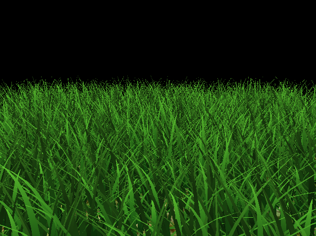

*The finished grass field.*

## Overview

This project simulates and renders a field of grass in real time with Vulkan, following the method in the [2017 paper by Jahrmann and Wimmer](https://www.cg.tuwien.ac.at/research/publications/2017/JAHRMANN-2017-RRTG/JAHRMANN-2017-RRTG-draft.pdf). Each blade is a quadratic Bezier curve that is updated on the GPU every frame.

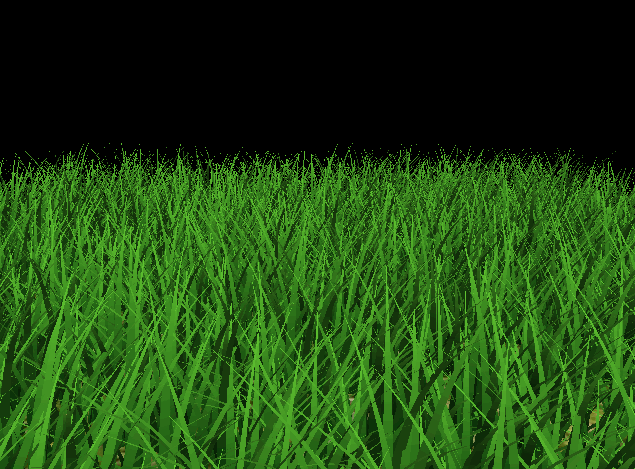

*Grass in the wind with a moving camera.*

A frame has two main stages:

* **Compute:** applies forces to every blade, tests each one for culling, and writes the survivors to a second buffer.
* **Graphics:** draws the surviving blades with an indirect draw call, then tessellates each one into a curved triangle.

## Features

### Tessellated Grass Blades

Each blade is stored as four vectors. The first three are the Bezier control points, and the spare `w` components hold the values that describe the blade:

* **`v0`:** the root position, plus the orientation angle.
* **`v1`:** the middle control point, plus the height.
* **`v2`:** the tip control point, plus the width.
* **`up`:** the up vector, plus the stiffness.

Each blade enters the pipeline as a patch with one control point. The tessellation control shader sets the tessellation levels, described under Tessellation Level of Detail below, and the evaluation shader uses De Casteljau's algorithm to find the curve position and tangent. It then tapers the width to a point at the tip.

The first fragment shader blends from dark green at the root to light green at the tip. Lighting is Lambert with a small ambient term, and it uses the absolute value of the dot product so that both faces are lit. The GIFs in this section and the next use this version, and so do the blade count, culling, and camera view performance tests.

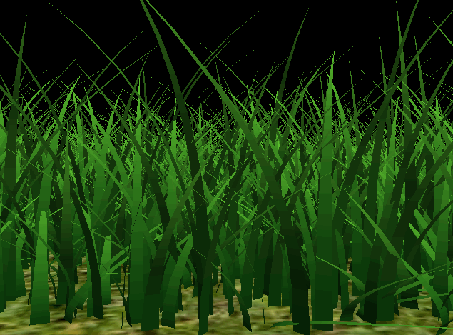

*Tessellated blades with no forces applied.*

### Physics Simulation

The compute shader moves `v2` every frame, using the sum of three forces:

* **Gravity:** pulls the tip down, with an extra forward component that makes the blade bend in the direction it faces.
* **Recovery:** pulls the tip back toward its rest position, scaled by the stiffness.
* **Wind:** blows in a fixed direction, with a strength made from two sine waves that vary over time and position. The force is stronger on blades that stand upright, and weaker on blades already leaning along the wind.

After the forces are applied, a validation step keeps the blade plausible. It keeps `v2` above the ground, recomputes `v1` from the new tip position, and corrects both points so that the blade length stays close to its height.

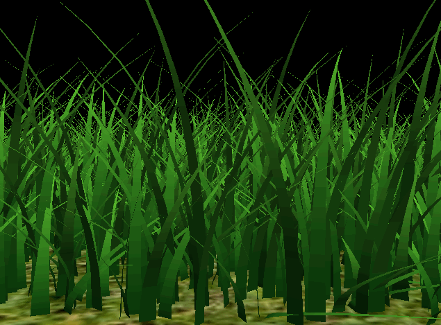

*Gravity, recovery, and wind applied.*

### Shading

The final shading keeps the root to tip gradient and adds a few inexpensive effects:

* **Color variation:** each blade gets a random brightness between 0.85 and 1.15 and a small warm or cool tint, from a hash of its root position. This breaks up the uniform green of the field.
* **Both faces lit:** the normal is flipped toward the camera, so whichever face is visible is shaded as the front.
* **Wrapped diffuse:** the diffuse dot product is remapped to the range 0 to 1 and squared, so faces turned away from the sun darken gradually instead of going flat.
* **Hemisphere ambient:** faces pointing up pick up a blue sky color, and faces pointing down a dim brown ground color.
* **Warm sun:** the direct light is tinted slightly yellow.
* **Translucency:** adds a faint yellow green glow, stronger near the tip, when the camera looks through a blade toward the sun. The sun is high in this scene, so the effect is subtle in these views.

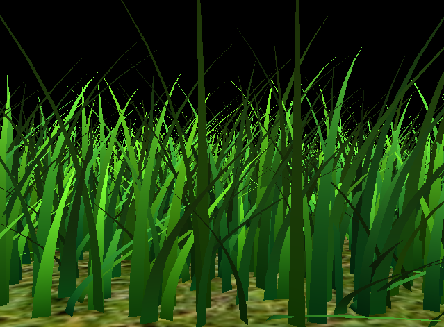

*Final shading.*

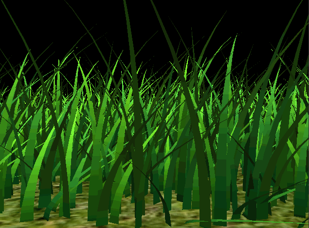

*Final shading in the wind.*

### Culling

The compute shader appends each surviving blade to the culled blades buffer, using `atomicAdd` on the `vertexCount` field of the indirect draw buffer. `vkCmdDrawIndirect` then reads that count, so the CPU never needs to know how many blades survived. The count is reset with `vkCmdFillBuffer` before each dispatch.

A blade is removed if it fails any of these tests:

* **Orientation:** removes blades seen close to side on, which cover fewer pixels. The threshold is 0.9.
* **View frustum:** removes blades whose `v0`, midpoint, and `v2` are all outside the frustum, with a tolerance of 0.1.
* **Distance:** removes a growing share of blades as their distance from the camera along the ground grows, using 10 buckets and a max distance of 30.

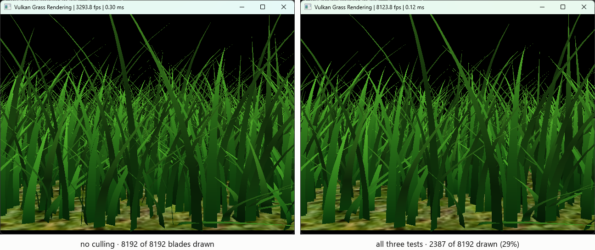

*Default view at 8192 blades. All three tests together draw 29% of the blades.*

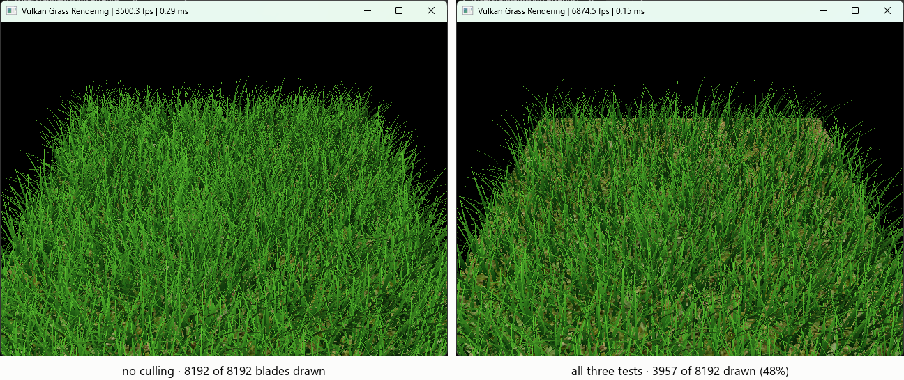

*High view at 8192 blades. Distance culling does most of the work here, and the ground shows through at the far end of the field.*

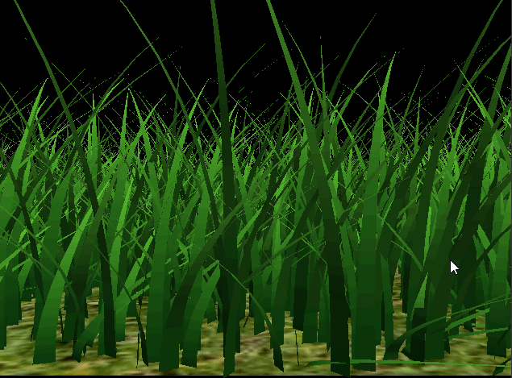

*The field thins out as the camera moves away.*

### Tessellation Level of Detail

The base code splits every blade into 8 × 8 segments. The final tessellation control shader reduces this in two steps:

* **Width:** each blade gets 1 segment across instead of 8. The position in the evaluation shader is linear across the blade, so the shape is exactly the same. Shading is also nearly the same, because the normal and `uv.y` do not depend on the position across the blade. The only difference is how `viewDir` is interpolated.
* **Distance:** the requested level along the blade falls from 8 at 10 units from the camera to 2 at 30 units, which is the distance culling limit.

The evaluation shader uses `fractional_odd_spacing`, so the segment lengths change smoothly as the level changes instead of popping. The cost is that each level is rounded up to an odd number of segments: a level of 8 gives 9 segments, and a level of 2 gives 3.

The `LOD` define in `grass.tesc` picks one of three settings:

* **0:** requests the base code's 8 × 8, which gives 9 × 9 segments after rounding.
* **1:** the width change only, 1 × 9 segments.
* **2:** the width change plus the distance change. This is the default.

There are three settings so that the two changes can be measured separately. The gap between 0 and 1 is the width saving, and the gap between 1 and 2 is the distance saving.

## Performance Analysis

All tests ran in Release at 640 × 480. Runs were shuffled so that slow drift over the session would not favor one configuration.

* **Blade count, culling, and camera view tests:** fixed 8 × 8 tessellation and the first fragment shader, before the final shading and LOD were added.
* **Tessellation tests:** the final shading and `fractional_odd_spacing`, with all culling on, run in a separate session.

Every test was measured the same way:

* **Repeats:** each configuration ran 3 times for 12 seconds.
* **Warm up:** the first second of each run was dropped.
* **Frame time:** the median of the one second averages in each run, then the mean of those medians across runs.
* **Blades drawn:** read back from the indirect draw buffer, so these counts come from the GPU.

### Number of Blades

> All culling makes frames 2.6 to 4.0 times faster from 16K blades up.

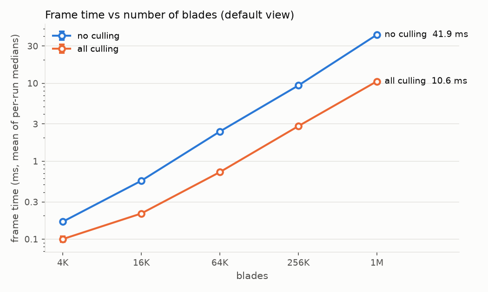

*Frame time against blade count from the default view, with culling off and on.*

| Blades | No culling (ms) | All culling (ms) | Speedup |
| --- | --- | --- | --- |
| 4096 | 0.167 | 0.100 | 1.7× |
| 16384 | 0.560 | 0.213 | 2.6× |
| 65536 | 2.398 | 0.723 | 3.3× |
| 262144 | 9.352 | 2.814 | 3.3× |
| 1048576 | 41.922 | 10.569 | 4.0× |

*Mean frame time for each blade count from the default view.*

Frame time grows close to linearly with blade count from 16K blades up. From 16K to 1M, the blade count grows 64 times, while frame time grows 75 times with no culling and 50 times with all culling.

All culling together makes frames 2.6 to 4.0 times faster in that range. At 1M blades, it raises the frame rate from 24 to 95 FPS. The 4K results are too close to the noise floor to compare reliably: with all culling, the runs vary by 8% between repeats, against about 1% or less everywhere else.

### Culling Tests

> Together the three tests draw 29% of the blades and save 70% of the frame time. Distance culling saves the most on its own.

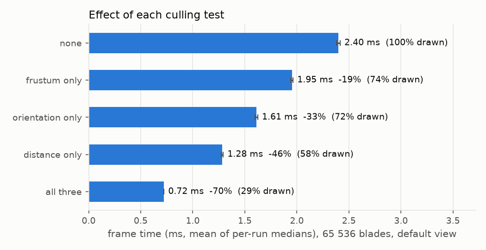

*Frame time for each culling configuration at 65536 blades from the default view.*

| Configuration | Blades drawn | Frame time (ms) | Blades removed | Time saved |
| --- | --- | --- | --- | --- |
| No culling | 100% | 2.398 | 0% | 0% |
| Frustum only | 74% | 1.953 | 26% | 19% |
| Orientation only | 72% | 1.612 | 28% | 33% |
| Distance only | 58% | 1.283 | 42% | 47% |
| All three | 29% | 0.723 | 71% | 70% |

*Blades removed against time saved, compared with no culling, at 65536 blades from the default view.*

All three tests together draw 29% of the blades and save 70% of the frame time. The tests are close to statistically independent: multiplying their individual drawn fractions predicts 31%.

Time saved does not exactly match the share of blades removed:

* **Frustum** saves less than it removes, likely because offscreen blades never reach the fragment stage.
* **Orientation and distance** save about 5 percentage points more than they remove, and the cause is unconfirmed.

### Camera Views

> The ranking of the tests changes with the camera, but all three together save 57% to 71% in every view.

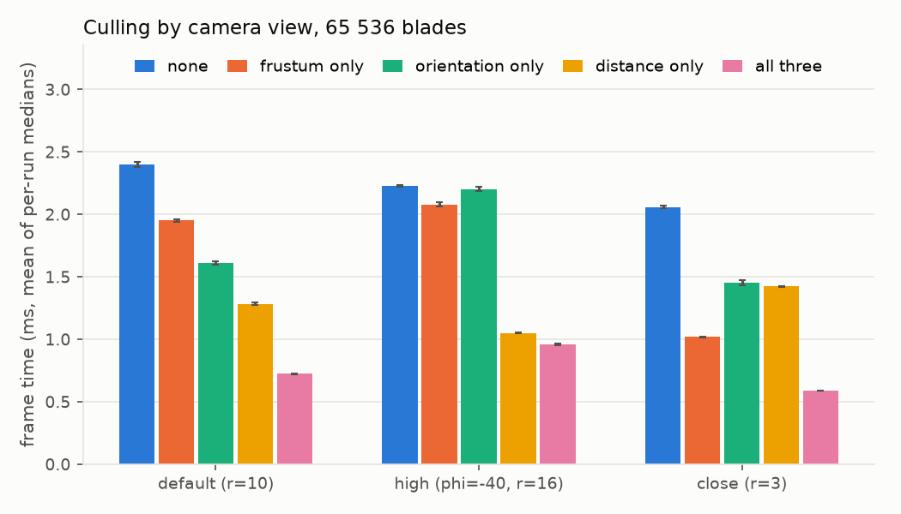

*The same five configurations at 65536 blades from all three camera views.*

| View | Frustum drawn | Orientation drawn | Distance drawn | All drawn | All time saved |
| --- | --- | --- | --- | --- | --- |
| Default (r = 10) | 74% | 72% | 58% | 29% | 70% |
| High (tilted 40° down, r = 16) | 93% | 100% | 53% | 48% | 57% |
| Close (r = 3) | 31% | 75% | 74% | 16% | 71% |

*Share of blades drawn by each test, and the time saved by all three, at 65536 blades.*

The value of each test depends on the camera, so a single view would give a misleading ranking:

* **Frustum** is the strongest test up close, where most blades are behind or beside the camera.
* **Orientation** does nothing from the high view, because the downward view direction keeps the dot product below 0.9 for almost every blade.
* **Distance** is the strongest test from the high view, and it gets weaker as the camera moves closer to the field.

The full set of tests saves a similar amount from the default and close views, even though a different test leads in each one.

### Tessellation Level of Detail

> Dropping the redundant width segments roughly halves the frame time. Distance LOD adds 7% to 8% from the high view and is close to the noise from the default view.

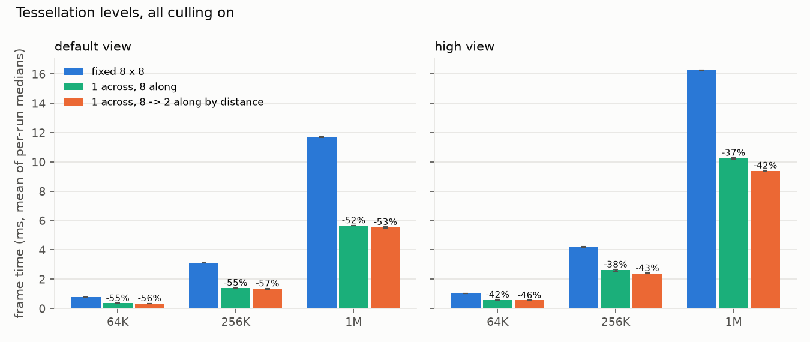

*Frame time for the three `LOD` settings with all culling on. The legend shows requested levels: fixed 8 × 8 is 9 × 9 segments after rounding. The percentages above the bars are relative to `LOD` 0, so the orange bars include the width saving.*

| View | Blades | LOD 0 (ms) | LOD 1 (ms) | LOD 2 (ms) | Width saving | Distance saving on top |
| --- | --- | --- | --- | --- | --- | --- |
| Default | 65536 | 0.798 | 0.357 | 0.352 | 55% | 1% |
| Default | 262144 | 3.122 | 1.409 | 1.333 | 55% | 5% |
| Default | 1048576 | 11.697 | 5.659 | 5.534 | 52% | 2% |
| High | 65536 | 1.029 | 0.599 | 0.560 | 42% | 7% |
| High | 262144 | 4.205 | 2.610 | 2.398 | 38% | 8% |
| High | 1048576 | 16.263 | 10.232 | 9.392 | 37% | 8% |

*Width saving is `LOD` 1 relative to `LOD` 0. Distance saving on top is `LOD` 2 relative to `LOD` 1, so it differs from the chart: for the high view at 1M blades, the chart shows 42% and the table 8%.*

All three settings draw the same blades, 29% from the default view and 48% from the high view, so the differences come from tessellation alone.

Dropping the width segments is the main win. It cuts each blade from 162 triangles to 18 and roughly halves the frame time: 52% to 55% from the default view and 37% to 42% from the high view. The saving is far less than 8/9, which suggests that much of the remaining time is spent outside tessellation. At 1M blades from the default view, the frame rate rises from 85 to 177 FPS, and to 181 FPS with distance LOD as well.

Distance LOD adds a small saving on top. From the high view it saves 7% to 8%, well above the noise. From the default view it saves 1% to 5%, which is close to the noise: the values do not grow steadily with blade count, and the 256K difference is only 2.2 times the larger standard deviation.

The gain is small because the field is small compared with the LOD range:

* **Default view:** blades are about 3 to 19 units from the camera. The farthest request a level of about 5, which rounds up to 7 segments.
* **High view:** blades are about 12 to 23 units away. The farthest request a level of about 4, which rounds up to 5 segments. This is likely why distance LOD saves more here.

Both views save almost the same absolute time from the width change, even though the high view draws 1.66 times as many blades:

* **64K:** 0.44 ms from the default view, 0.43 ms from the high view.
* **256K:** 1.71 ms and 1.60 ms.
* **1M:** 6.04 ms and 6.03 ms.

The cause is unconfirmed. Since the high view has a higher frame time, the same saving is a smaller percentage there.

### Limitations

* Results apply to this scene, window size, and these three cameras.
* All runs use the same blade layout, so the error bars show timing repeatability only.
* Orientation and distance culling change the image, so their savings are not free.
* The final shading and the switch to `fractional_odd_spacing` together cost about 10% more frame time, and this data cannot separate the two. The spacing change alone turns 8 × 8 segments into 9 × 9, which is 27% more triangles. With all culling from the default view, frame time went from 0.723 to 0.798 ms at 64K, 2.814 to 3.122 ms at 256K, and 10.569 to 11.697 ms at 1M. The two sets ran in different sessions, so this is a rough comparison.
* Distance LOD was only tested with near and far distances of 10 and 30. A smaller far distance, such as 20, might save more, but it was not tested.
* The visual effect of distance LOD was not evaluated. In the tested views, the farthest blades drop to 5 segments, and the formula allows as few as 3, so their curves are less smooth. The width change does not change the shape.

## CMake Changes

* `external/GLFW/CMakeLists.txt`: removed `cmake_policy(SET CMP0042 OLD)`. CMake 4 no longer allows this policy to be set to OLD, and it only affects macOS.
* `src/CMakeLists.txt`: added the `DATA_DIR` compile definition so `main.cpp` can write the performance CSVs to `data/`.

With CMake 4, also set `CMAKE_POLICY_VERSION_MINIMUM` to 3.5 when configuring, because the project declares a minimum version older than CMake 4 accepts.
