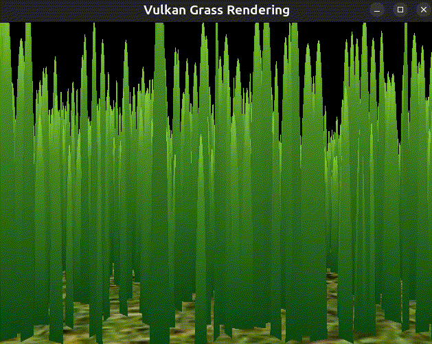
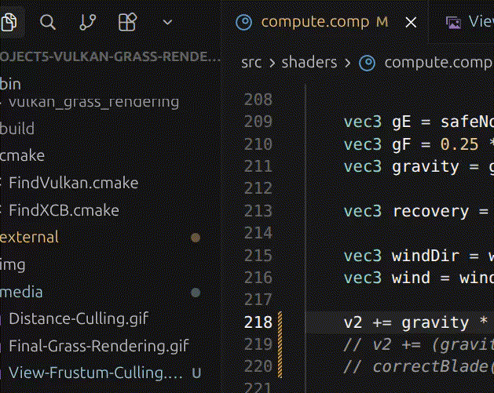
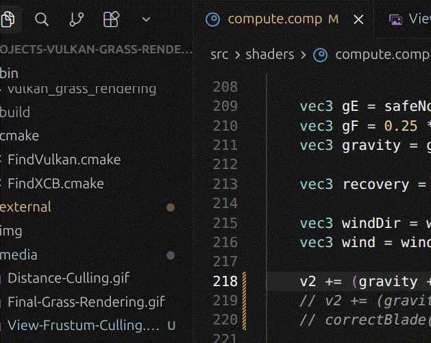
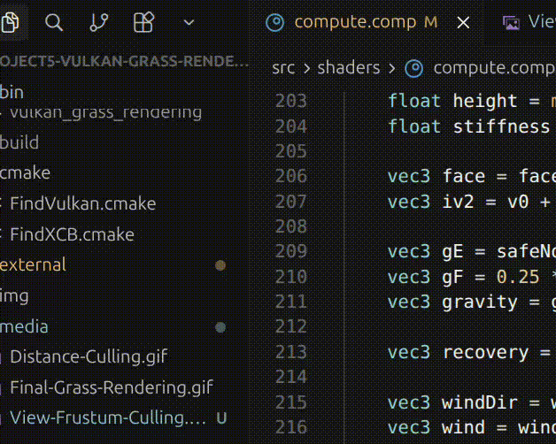
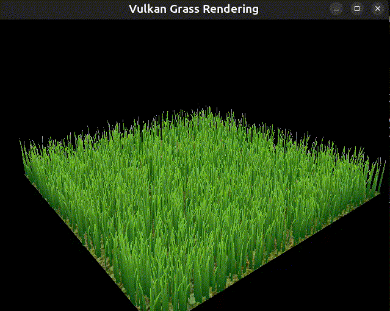
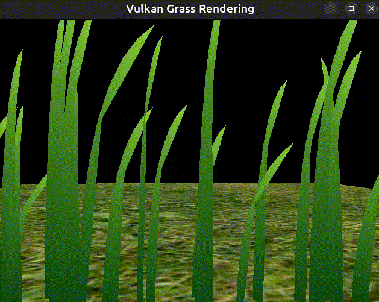
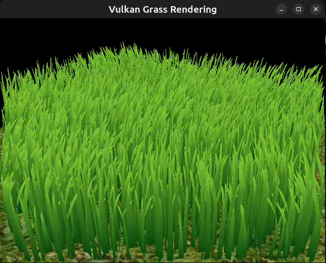

Vulkan Grass Rendering
==================================

**University of Pennsylvania, CIS 565: GPU Programming and Architecture, Project 5**

* Yanfu Ou
* Tested on: Ubuntu24.04, Ryzen4-7480HS @ 3.0GHz 64GB DDR4, RTX5070 8GB

### Overview

2^13(8192) grass blades. 

This project used Vulkan to render physics realistic grass, and is an implementation of the paper [Responsive Real-Time Grass Rendering for General 3D Scenes](https://www.cg.tuwien.ac.at/research/publications/2017/JAHRMANN-2017-RRTG/JAHRMANN-2017-RRTG-draft.pdf). In the simulation, a blade of grass is described by three vertices, v0, v1, and v2, which are the control points of a Bezier curve. To make the movement of grass more realistic, the simulator also take into account gravity, recovery, and wind. In order to make the simulation computationally efficient, the simulator culls grass blades that are not visible, implementing distance and orientation culling. 

### Rendering 
This is a render of still grass without any forces

### Forces 
#### Gravity

#### Gravity and recovery

#### Gravity and recovery and wind

#### Gravity, recovery, wind and corrected grass

### Culling
#### Distance Culling
Blades that are too far away to be seen in detail are culled. 

#### Orientation Culling 
Blades that are views at almost an edge are culled. 

#### View-frustum Culling

## Performance

### Number of Blades

| Blade Count(no culling) | 2^9  | 2^11 | 2^13 | 2^15 | 2^17 | 2^19 | 2^21 | 2^23 | 2^25 |
|-------------------------|------|------|------|------|------|------|------|------|------|
| FPS                     | 3685 | 2957 | 1347 | 536  | 177  | 52   | 15   | 4    | 1    |

