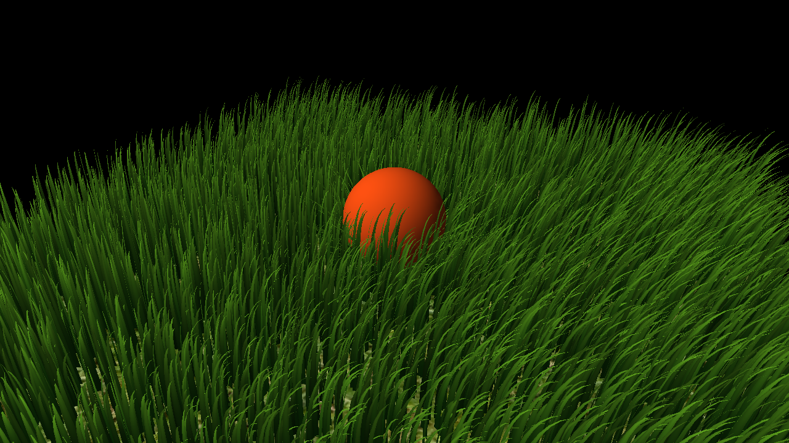

# Vulkan Grass Rendering

**Qingyao Tian** · University of Pennsylvania, CIS 565: GPU Programming and Architecture · Project 5

A Vulkan grass renderer with GPU simulation, visibility culling, distance-based tessellation, and interactive sphere contact. Quadratic Bézier blades bend under wind and gravity, respond to a moving sphere, and recover while their roots remain anchored to the ground.



*Interactive grass with wind, GPU culling, and distance LOD enabled.*

[Single-blade physics](docs/media/single-blade-physics.gif) → [Wind and culled field](docs/media/wind.gif) → [Distance LOD](docs/media/lod-comparison.webm) → [Interactive grass](docs/media/interactive-comparison.webm). [Close-up contact and recovery](docs/media/single-blade-contact.webm).

## Implemented features

- **Procedural grass:** tapered Bézier ribbons generated through Vulkan tessellation, with randomized height, width, orientation, and stiffness.
- **GPU simulation:** gravity, recovery, and spatially varying wind update persistent blade state at a fixed 1/120-second timestep. Curve correction keeps roots fixed, tips above the ground, and estimated blade length consistent.
- **GPU culling and indirect drawing:** frustum, orientation, and distance tests compact surviving blades into a render buffer and write the indirect draw count. All blades continue simulation, including those outside the current view.
- **Distance LOD — extra credit:** requested tessellation decreases smoothly from 8 to 2 along each blade over camera distances of 15–45 world units. Fractional-even tessellation supports gradual transitions; a color view visualizes detail levels.
- **Interactive grass — extra credit:** a controllable sphere pushes blades aside through sampled curve contact and swept sphere paths. Bounded corrections keep the response stable, and recovery restores blades after contact ends. Manual, orbit, and straight-pass motion share the simulation clock.
- **Inspection tools:** single-blade and patch scenes, wireframe rendering, force/culling switches, pause and single-step controls, GPU timestamps, and CSV diagnostics.

## Rendering pipeline

`Update sphere path → simulate blades → correct curves → cull and compact → indirect draw → distance-based tessellation → shade`

Each compute invocation owns one blade. Its three control points describe the curved centerline, while tessellation produces the final ribbon. Simulation state remains separate from the compacted draw buffer, so camera movement and LOD changes preserve the ongoing animation.

The main implementation is in [compute.comp](src/shaders/compute.comp), [grass.tesc](src/shaders/grass.tesc), [grass.tese](src/shaders/grass.tese), and [Scene.cpp](src/Scene.cpp).

## Performance highlights

Measurements use an **RTX 4070 Laptop GPU**, Windows, Release builds, and a **1280 × 720** framebuffer. GPU timestamps cover compute and graphics. Culling results use the median of three run medians, with 240 warmup and 960 measured frames per run; LOD uses four paired runs per configuration.

For **65,536 blades**, fixed-detail culling results are:

| Culling mode | Overview GPU time | Far-view GPU time |
| --- | ---: | ---: |
| None | 0.508 ms | 0.450 ms |
| Frustum | 0.507 ms | 0.448 ms |
| Orientation | 0.473 ms | 0.357 ms |
| Distance | 0.404 ms | 0.167 ms |
| All three | **0.378 ms** | **0.129 ms** |

Combined culling reduces GPU time by **25.7% in the overview** and **71.3% in the far view**. Distance thinning provides the largest far-view benefit; orientation testing removes blades seen nearly edge-on. Frustum culling contributes little in views where the whole field is already inside the camera. With culling disabled, increasing density from 8,192 to 131,072 blades raises overview GPU time from **0.086 to 1.011 ms**.

In a separate 65,536-blade far-view comparison with culling enabled, **LOD reduces graphics time from 0.116 to 0.063 ms (45.8%)**, alongside **53.2% fewer tessellation-evaluation invocations**. It reduces per-blade geometry while preserving the same simulation state and visible blade set.

Validation combines an independent CPU reference with sustained-contact, recovery, fast-motion, offscreen-update, and 30/120 FPS consistency checks. Supporting plots cover [density scaling](docs/images/density-performance.png), [culling](docs/images/culling-performance.png), [LOD](docs/images/lod-performance.png), and [contact recovery](docs/images/interaction-recovery.png). [Measurement summaries and validation data](docs/data/) preserve the experiment configurations and results.

## Build and run

The tested Windows setup uses **Visual Studio 2022 C++ tools, CMake 3.31, and Vulkan SDK 1.4.363.0**. GLFW, GLM, and stb are bundled in `external/`. From the repository root:

```powershell
cmake -S . -B build -G "Visual Studio 17 2022" -A x64
.\run-interactive.cmd
```

The launcher builds Debug and starts the sphere demo from the shader/texture working directory. Additional examples:

```powershell
.\run-interactive.cmd --sphere-motion orbit
.\run-debug.cmd --blades 65536 --culling all
.\run-debug.cmd --scene single --wireframe
```

| Control | Action |
| --- | --- |
| Left drag; wheel or right drag | Orbit; zoom. |
| Space / N / R | Pause or resume / advance one physics step / reset. |
| G / B / W | Toggle gravity / recovery / wind. |
| C; L / H | Cycle culling; toggle LOD / LOD colors. |
| Arrow keys; Q / E | Move the sphere horizontally; lower / raise it. |
| I / P / T | Toggle contact / switch manual and orbit motion / reset the sphere. |

Selected figures, videos, measurement summaries, and numerical checks are collected in [docs](docs/).

## Credits

Built on the CIS 565 Vulkan starter framework. The grass model, forces, and culling follow [Responsive Real-Time Grass Rendering for General 3D Scenes](https://www.cg.tuwien.ac.at/research/publications/2017/JAHRMANN-2017-RRTG/JAHRMANN-2017-RRTG-draft.pdf) and the course materials. Runtime dependencies are [GLFW](external/GLFW/), [GLM](external/glm/), and [stb](external/stb/); offline analysis uses NumPy, Pillow, and Matplotlib.
