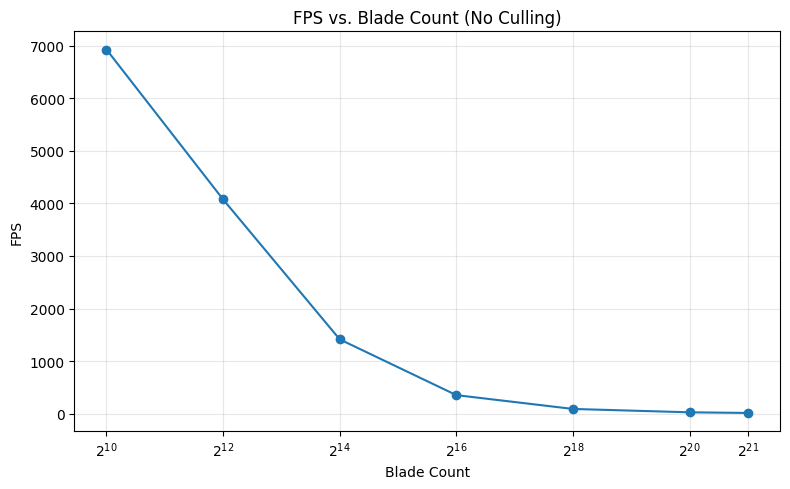
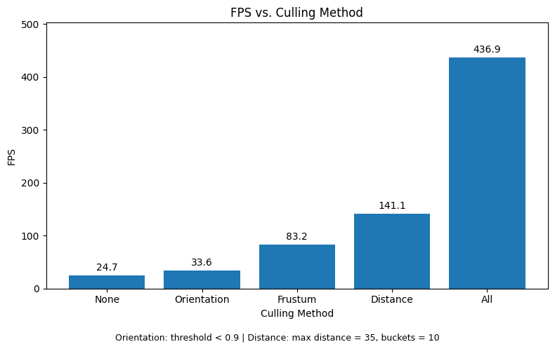

Vulkan Grass Rendering
==================================

**University of Pennsylvania, CIS 565: GPU Programming and Architecture, Project 5**

* Rayyan Shaik - [LinkedIn](https://www.linkedin.com/in/rayyan-shaik)
* Tested on: Tested on: Windows 11, AMD Ryzen 7 5700H @ 3.3GHz 32GB, Mobile RTX 3070 (Personal Computer)

## Overview
At a high level, this project implements [Responsive Real-Time Grass Rendering for General 3D Scenes](https://www.cg.tuwien.ac.at/research/publications/2017/JAHRMANN-2017-RRTG/JAHRMANN-2017-RRTG-draft.pdf) by Jahrmann and Wimmer in Vulkan. This project renders grass in Vulkan using tessellated Bezier curves to represent individual blades, with forces such as wind and gravity shaping their motion. GPU-based (compute shader) culling removes blades that do not contribute to the current view, reducing rendering work and improving performance in dense grass fields.

## Features

### Grass Geometry + Rendering

### Physics - Simulating External Forces

### Culling (Rendering Optimizations)

## Performance Analysis

### Number of Blades
| __Blade count (no culling)__ | 2^10 | 2^12 | 2^14 | 2^16 | 2^18 | 2^20 | 2^21 |
|---|---|---|---|---|---|---|---|
| __FPS__ | 6929.9 | 4076.3 | 1412.9 | 351.6 | 88.6 | 24.6 | 12.4 |

_This scene used a 20x20 grid as a floor plane and the camera was set to a fixed position_

### Culling Methods

| __Culling__ | None | Orientation | Frustum | Distance | All |
|---|---|---|---|---|---|
| __FPS__ | 24.7 | 33.6 | 83.2 | 141.1 | 436.9 |
| __Settings__ | — | Threshold < 0.9 | — | Max dist = 35; buckets = 10 | — |

_This scene used 2^20 blades, a 50x50 grid as a floor plane, and the camera was set to a fixed position_

