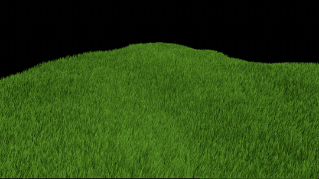
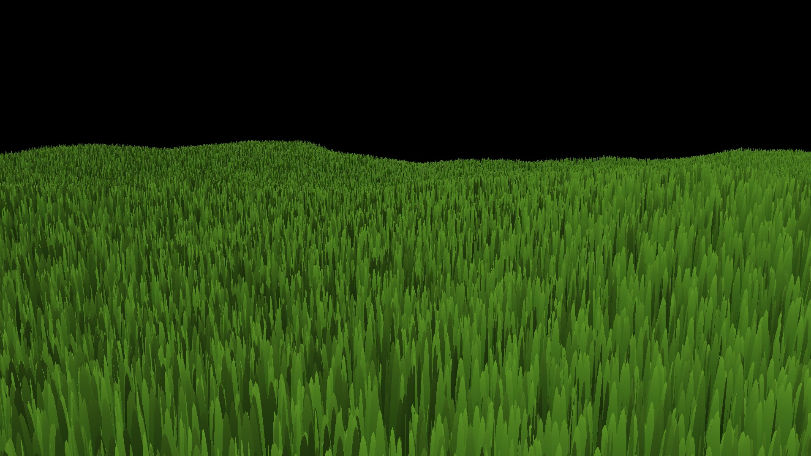
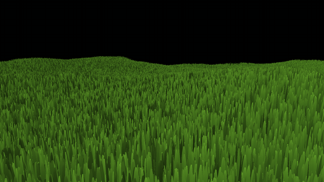
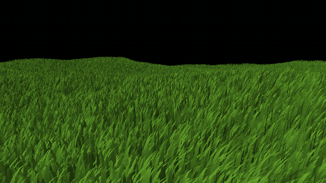
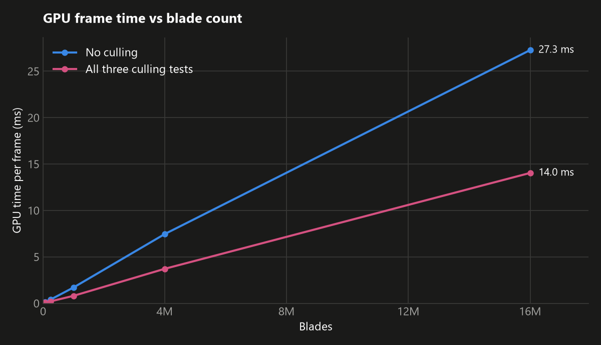
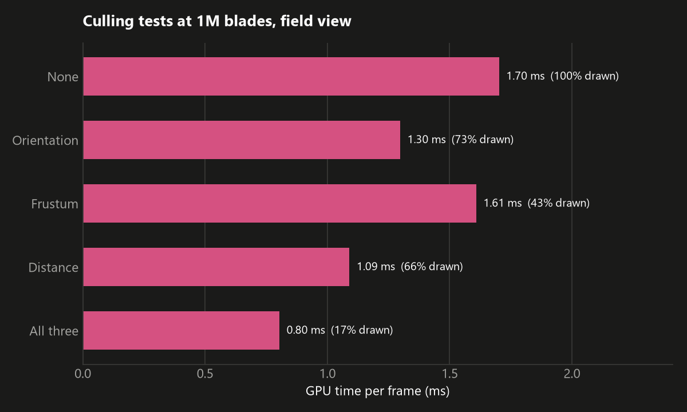

Vulkan Grass Rendering
==================================

**University of Pennsylvania, CIS 565: GPU Programming and Architecture, Project 5**

* Yichen Huang
    - [LinkedIn](https://www.linkedin.com/in/yichen-huang-970b582bb/), [personal website](https://as7tesia.com/)
* Tested on: Windows 11, AMD Ryzen 9 5950X, 64GB, RTX 5070 Ti 16GB

  
   
  <em>Fly Through</em>

1M blades on a 128 m procedural terrain, all three culling tests on. FPS seems low due to GIF compression, for detailed performance analysis please see section below.

This project renders a field of grass in Vulkan, following Jahrmann and Wimmer's *Responsive Real-Time Grass Rendering for General 3D Scenes*. Each blade is a quadratic Bezier curve that a compute shader simulates and culls every frame, and the surviving blades are tessellated into geometry on the GPU.

## Features

**Simulation**
* [Bezier blade model](#blade-model-and-tessellation) tessellated into a tapered blade
* [Gravity, recovery and wind](#forces), with state validation that keeps blades above the ground and at their rest length

**Culling**
* [Orientation, frustum and distance culling](#culling) in the compute pass
* Survivors appended with one atomic per subgroup and drawn with `vkCmdDrawIndirect`

**Scene**
* [Perlin terrain](#terrain-and-lushness) with a lushness field that drives blade density, height and width

## Rendering pipeline

1. Compute pass -> applies forces to every blade, validates its state, runs the three culling tests and appends the surviving blades to a culled buffer, counting them into an indirect draw command.
2. Terrain draw -> the terrain mesh with procedural soil color.
3. Grass draw -> `vkCmdDrawIndirect` issues one patch per surviving blade. The tessellation control shader sets the levels, the evaluation shader places vertices on the curve, and the fragment shader shades both sides of the blade with Lambert.

## Rendering features

### Blade model and tessellation

Each blade stores three control points: `v0` on the ground, `v2` at the tip as the guide that physics moves, and `v1` above `v0` that the compute shader rebuilds from `v2` every frame. The per-blade orientation, height, width and stiffness ride in the `w` components. The tessellation evaluation shader evaluates the curve with de Casteljau, and narrowing at the tip. Each blade is tessellated into 2 segments across and 8 along.

  
   
  <em>Static blades only with no forces</em>

### Forces

The compute shader moves `v2` by three forces each frame:

* **Gravity**: a downward pull plus a forward component along the blade's facing, so blades bend in the direction they face.
* **Recovery**: a spring back toward the upright position, scaled by the blade's stiffness.
* **Wind**: a field of layered sine waves over position and time. The frequencies are non-multiples of each other so the pattern does not visibly repeat, and a slow envelope makes the gusts rise and fall. Blades already aligned with the wind feel less of it.

After the forces, state validation pushes `v2` back above the ground, rebuilds `v1` from how far the tip has tipped over, and rescales both so the curve keeps the blade's height as its length.

| Gravity and recovery | Wind |
| :---: | :---: |
|  |  |

### Terrain and lushness

The ground is a 128 m terrain from five octaves of Perlin noise (GLM's `glm::perlin`), with hills up to about 6 m. A second, lower frequency noise field gives each spot a lushness value. Blades are scattered with rejection sampling against lushness, so lush patches are denser, and their height and width scale with it. The soil color mixes two browns and a moss tone by lushness per vertex, and the fragment shader adds value noise detail on top so the 0.5 m grid does not show.

### Culling

Every test runs per blade in the compute pass:

* **Orientation**: blades seen edge-on, where the view direction lies along the blade's width, are culled (threshold 0.9).
* **Frustum**: a blade is culled when its root, its tip and the curve's midpoint all fall outside the view frustum, with a 10% margin.
* **Distance**: blades within 15 m of the camera (ground distance) are all kept. From there to 120 m, the density drops by a tenth at each of 9 evenly spaced steps, picking blades by index, and nothing past 120 m is kept.

The survivors are written to the culled buffer with warp-aggregated atomics: `subgroupBallot` counts the visible lanes, one lane reserves space for all of them with a single `atomicAdd`, and each lane writes at its prefix offset.

## Performance

All numbers come Release build, validation layers off, 1920x1080, simulation stepped at a fixed 1/60 s. GPU timestamp queries surround the compute dispatch and the terrain and grass draws. Each run reports the median of 300 frames, and each data point is the fastest of 3 interleaved runs.

### Blade count

We can see that frame time grows linearly with blade count, apart from a small fixed cost below about 64K blades. From 1M blades up, culling roughly halves the frame, since every blade is still simulated and tested each frame.

### Culling tests

With all three culling methods, about 17% of the blades are drawn and the frame takes 0.80 ms instead of 1.70 ms, of which 0.17 ms is the compute pass. Distance culling keeps two thirds of the blades in this view but still saves 0.61 ms, more than frustum culling, which removes 57% of the blades and saves only 0.09 ms. My guess is that off-screen blades were already cheap, since the rasterizer clips them after tessellation and they never produce fragments, while the far blades that distance culling thins out are still on screen as many tiny triangles, which rasterize poorly. Orientation culling removes 27% of the blades and saves 0.40 ms.

### Compaction and buffer memory

* **Subgroup ballot vs plain `atomicAdd`**: no measurable difference in the compute pass at 1M or 4M blades, with or without culling. I believe NVIDIA's compiler already aggregates atomics to a single address within a warp, which is what the ballot does by hand.
* **Culled buffer in `DEVICE_LOCAL` vs `HOST_VISIBLE`**: the base code allocated the culled buffer as `HOST_VISIBLE`, which on this machine lands in system memory. With no culling at 1M blades, the compute pass writes and the vertex fetch reads 64 MB across PCIe every frame, and the frame takes 22.2 ms instead of 1.70 ms. Moving it to `DEVICE_LOCAL` fixed it.

### Controls
Basically same as Unreal Engine.

### Building

* `src/CMakeLists.txt` passes `--target-env vulkan1.1` to `glslangValidator`. The subgroup ballot needs SPIR-V 1.3, which the default Vulkan 1.0 target does not allow. This is the only change to the CMake files.
* CMake 4 cannot configure the bundled GLFW (it sets policy CMP0042 to OLD), so I configured with the CMake 3.29 that ships with Visual Studio 2022.

## Credits

* Jahrmann and Wimmer, [Responsive Real-Time Grass Rendering for General 3D Scenes](https://www.cg.tuwien.ac.at/research/publications/2017/JAHRMANN-2017-RRTG/JAHRMANN-2017-RRTG-draft.pdf), I3D 2017
* [GLM](https://github.com/g-truc/glm) for math and Perlin noise, [stb_image_write](https://github.com/nothings/stb) for PNG capture
