# Vulkan Grass Rendering

**University of Pennsylvania, CIS 565: GPU Programming and Architecture, Project 5**

- [Didrik Wiig-Andersen](https://github.com/didrikwiigandersen)
- Tested on: Ubuntu 24.04.4 LTS, AMD EPYC 7R32 (4 vCPUs), 15.4 GiB usable RAM, NVIDIA A10G with 23,028 MiB reported VRAM (AWS g5.xlarge).
- Late days used: 1

[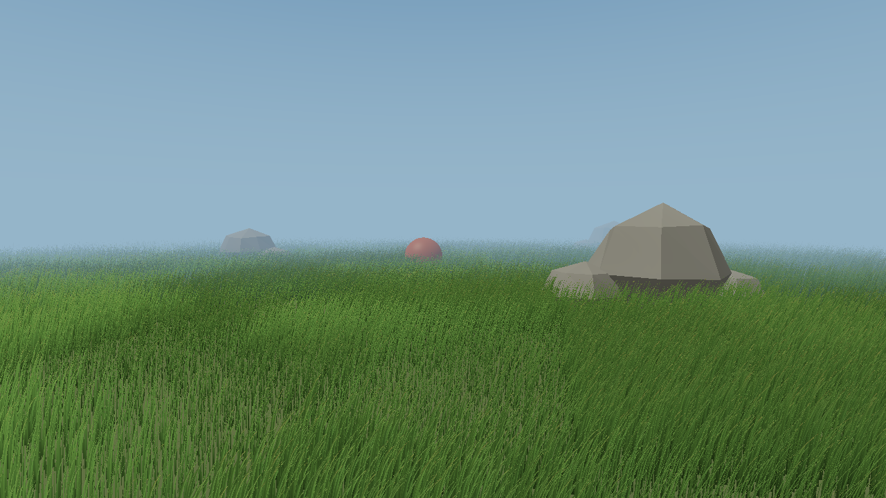](img/controls-walkthrough.mp4)

[Watch the controls walkthrough](img/controls-walkthrough.mp4): camera orbit and zoom, sphere movement, wind, all culling switches, tessellation, shading, pause, reset, and exit. Captions identify the actual mouse and keyboard inputs.

A GPU-driven grass simulator and renderer. Each blade remains a compact quadratic Bézier curve during simulation and visibility testing; the graphics pipeline tessellates surviving curves into tapered geometry. Wind, gravity, elastic recovery, and a moving sphere shape the field without transferring the blade population back to the CPU.

## From curves to a meadow

Clips are captured at 1280 × 720 with 30 simulation steps per second, then exported as 720-pixel-wide, 20 FPS GIFs. [Media settings and encoding commands](img/media.json) preserve the capture recipe.

| Stage | Demonstration |
| --- | --- |
| Static curves, tessellation, and basic lighting | 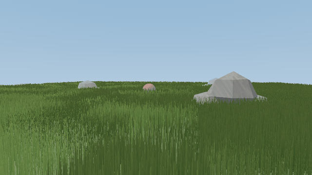 |
| Gravity, recovery, and coherent traveling wind | 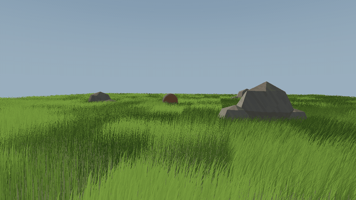 |
| GPU visibility tests and indirect rendering |  |

The simulation follows [Jahrmann and Wimmer’s responsive grass model](https://www.cg.tuwien.ac.at/research/publications/2017/JAHRMANN-2017-RRTG/JAHRMANN-2017-RRTG-draft.pdf). Four `vec4` values store a blade’s root, curve guide, physical tip, up vector, orientation, rest height, width, and stiffness. Every blade continues simulating, including those outside the camera’s view.

The compute pipeline applies environmental and front gravity, stiffness-based recovery, and a spatially coherent wind field. It projects displaced tips above the ground, reconstructs the guide, and corrects the paper’s approximate curve length. Visible blades are compacted into a device-local vertex buffer and rendered with a GPU-written indirect command. Counter initialization occurs before the visibility dispatch.

Three independently switchable visibility tests remove blades that contribute little to the image:

- **Orientation:** removes nearly edge-on blades using the lateral direction of the blade and a dot-product threshold of 0.98. The narrow threshold preserves coverage within coherently oriented clumps.
- **Frustum:** uses the curve’s root, midpoint, tip, and conservative bounds with Vulkan’s zero-to-one clip-depth convention.
- **Distance:** reduces retained density in stable distance buckets and removes blades beyond the configured range. Selection depends on persistent identity rather than compacted output order.

## Extra Credit

### LOD

The tessellation control shader changes the number of longitudinal segments with camera distance. Geometry detail and retained blade density have separate controls. The wireframe view exposes the geometry change directly. This debug clip uses 32,768 blades so the individual tessellated strips remain visible.

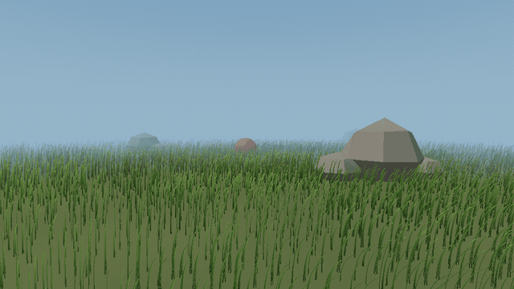

| Fixed tessellation | Adaptive tessellation |
| --- | --- |
| 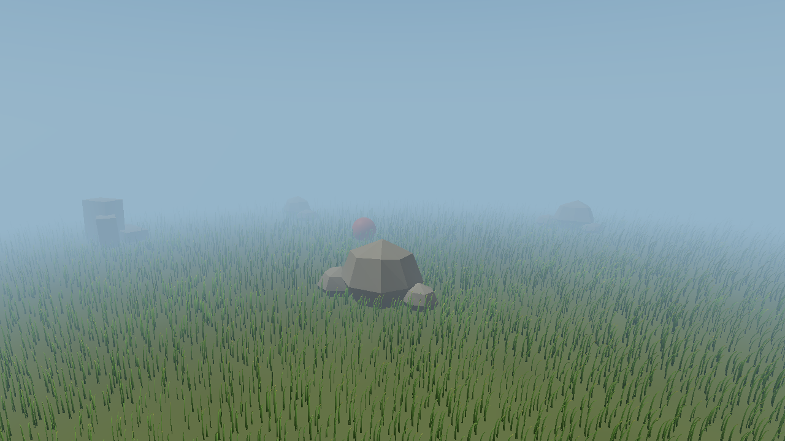 | 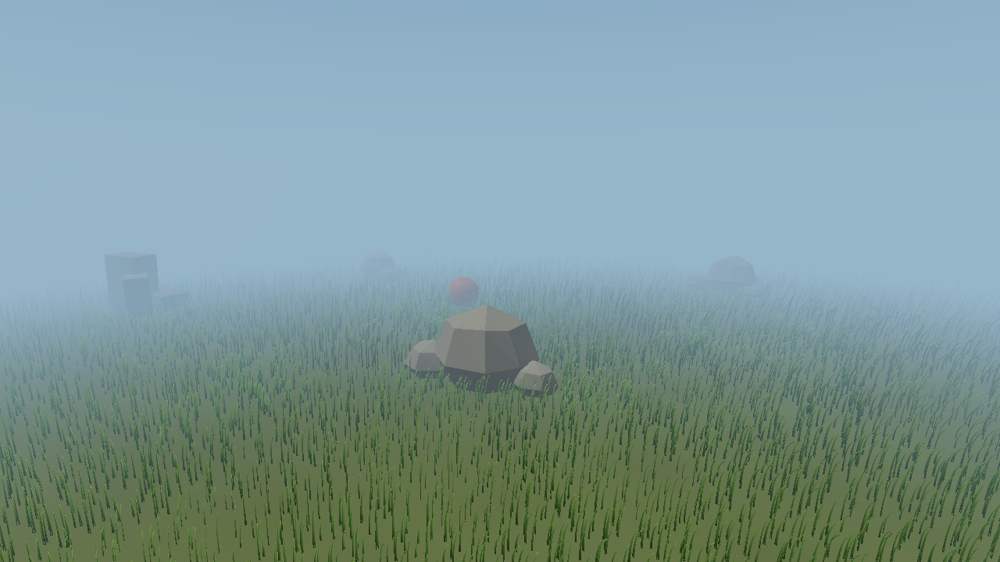 |

These matching overview captures use 32,768 blades and the same camera, seed, simulation time, and culling. Only longitudinal tessellation changes.

### Occlusion culling

Procedural stones and the interactive sphere provide opaque blockers. A same-frame depth prepass feeds a maximum-depth hierarchy. Visibility tests conservatively compare projected blade bounds against this hierarchy; uncertain bounds and near-plane crossings remain visible. Disabling occlusion also skips its additional prepass and hierarchy work.

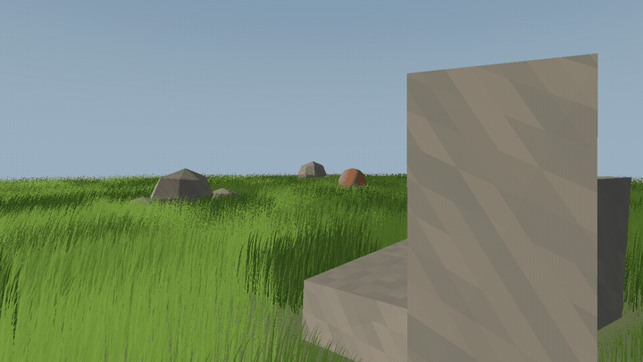

| Occlusion disabled | Occlusion enabled |
| --- | --- |
| 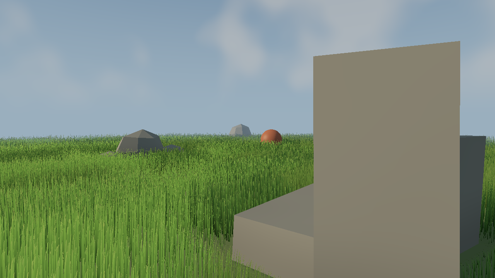 |  |

The visible draw count falls from 83,247 to 57,221 with no visible image change. The captures differ at one of 921,600 pixels; repeating the disabled case produces the same pixel variation, consistent with overlapping blades sharing quantized depth. [The comparison and repeat controls](performance/validation/visual-report.json) record its position and color difference.

### Interactive grass

A controllable sphere bends nearby grass using four contact samples along each curve. The same frame snapshot drives contact response, object rendering, and visibility. Elastic recovery returns displaced grass toward equilibrium after the sphere passes. Keyboard controls also change wind direction and strength.

The close demonstration isolates contact with zero wind: an undisturbed field, a slow sphere passage, and recovery. Collision checks sample four locations along each curve. The sphere starts at ground contact, and manual vertical movement keeps it above the ground.

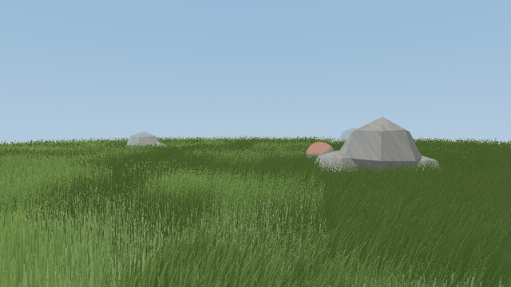

In a fixed central cohort of 13 blades, the median peak tip displacement is 1.37 blade heights relative to a matching interaction-disabled run. All 13 recover to within 10% of their individual peak displacement during the two-second recovery check. [Recorded checks](performance/validation/visual-report.json) and the [interaction-on](performance/validation/physics-on.csv) / [interaction-off](performance/validation/physics-off.csv) trajectories preserve the measurements.

### Better rendering

Warm late-afternoon sunlight and cool sky illumination shape the meadow. A procedural sky includes a sun disc and soft clouds. Stones and the sphere cast filtered directional shadows onto the ground and grass. Two-sided blade shading combines root-to-tip color variation, rounded normals, transmission, and restrained highlights; lighter atmospheric haze preserves contrast in the middle distance.

Each blade uses a continuous frame along its curve, including strong bends. Static-object footprints exclude roots, and nearby grass becomes shorter so its full bending reach stays outside the stones. Related blades form coherent clumps. All geometry and shading are generated in this project.

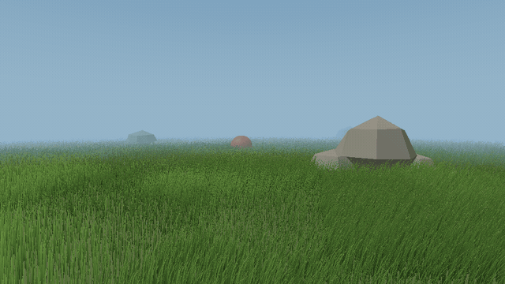

| Close blade shading | Color variation disabled |
| --- | --- |
|  | 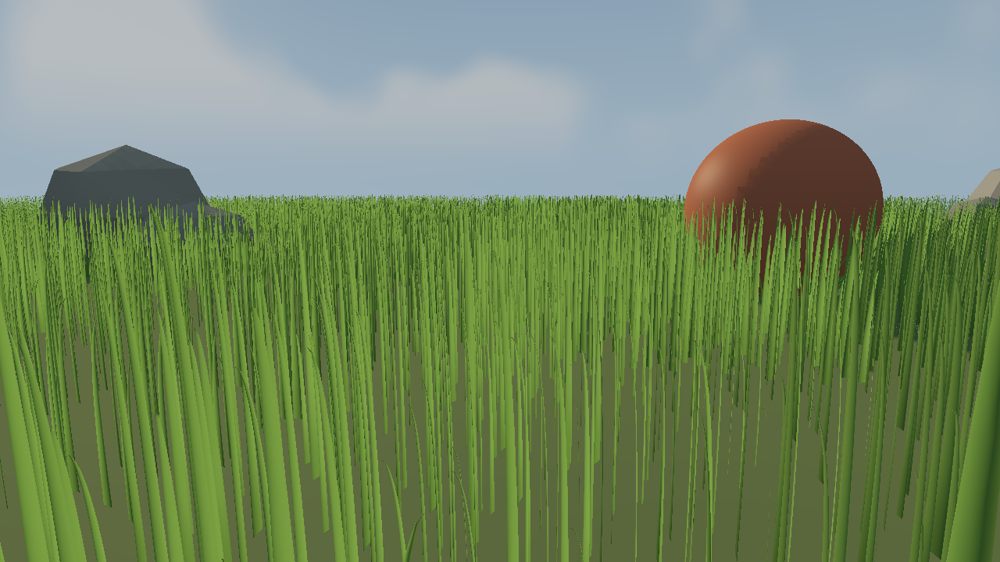 |

| Directional shadows | Shadows disabled |
| --- | --- |
|  | 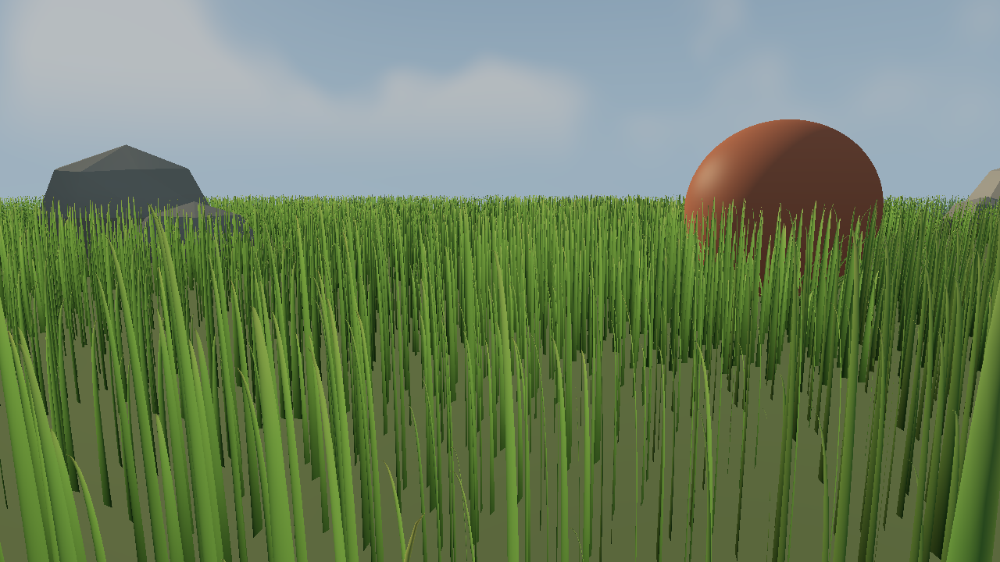 |

The comparisons preserve camera, seed, simulation state, sun, and exposure. Further matching views isolate [rounded normals](img/detail-no-rounded-normals.png), [transmission](img/detail-no-transmission.png), [specular highlights](img/detail-no-specular.png), [the sky](img/beauty-no-sky.png), and [fog](img/beauty-no-fog.png).

## Performance

All timings below are GPU frame spans in milliseconds, measured in **Release** at **1280 × 720**. Each configuration excludes 120 warmup frames and records 300 frames, repeated three times in a deterministic shuffled order. Values are the median of the three run medians. The 87 runs contain **26,100 measured frames**.

| Test environment | Configuration |
| --- | --- |
| GPU | NVIDIA A10G, 23,028 MiB reported VRAM, driver 615.71.10 |
| CPU / memory | AMD EPYC 7R32, 4 vCPUs, 15.4 GiB usable system memory |
| OS / compiler | Ubuntu 24.04.4 LTS, Linux 7.0.0-1012-aws, GCC 13.3.0 |
| SDK / build | Vulkan SDK 1.4.363.0, device API 1.4.351, CMake 3.28.3 |
| Fixed scene | Seed 5650, 64 × 64 field, 1/60-second simulation steps |
| Baseline controls | `culling` preset, `overview` camera, 12 fixed length segments, LOD and occlusion off |

Each comparison preserves camera, field area, wind progression, and simulation stepping. All cases use GPU compaction and indirect drawing. Validation, captures, video encoding, and blade-state verification are disabled during timing. Submission waits for swapchain acquisition before the opening GPU timestamp.

### Blade-count scaling

| Blades | None | Orientation | Frustum | Distance | All three |
| ---: | ---: | ---: | ---: | ---: | ---: |
| 8,192 | 0.0827 | 0.0820 | 0.0729 | 0.0546 | 0.0504 |
| 32,768 | 0.2341 | 0.2284 | 0.1917 | 0.1023 | 0.0819 |
| 131,072 | 0.8570 | 0.8310 | 0.6653 | 0.3311 | 0.2350 |
| 524,288 | 3.2667 | 3.1627 | 2.5143 | 1.2186 | 0.8185 |
| 1,048,576 | 6.4466 | 6.2399 | 4.9414 | 2.3914 | 1.5845 |

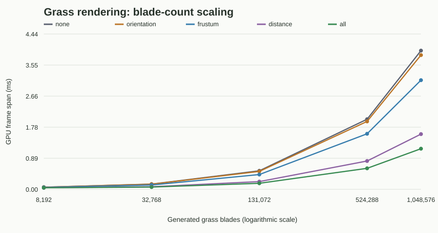

Doubling from 524,288 to 1,048,576 blades changes the unculled result from 3.2667 to 6.4466 ms. At one million blades, all three tests retain approximately 174,988 blades and provide a **4.07× speedup**, with **75.4% less GPU time**.

### What each culling test saves

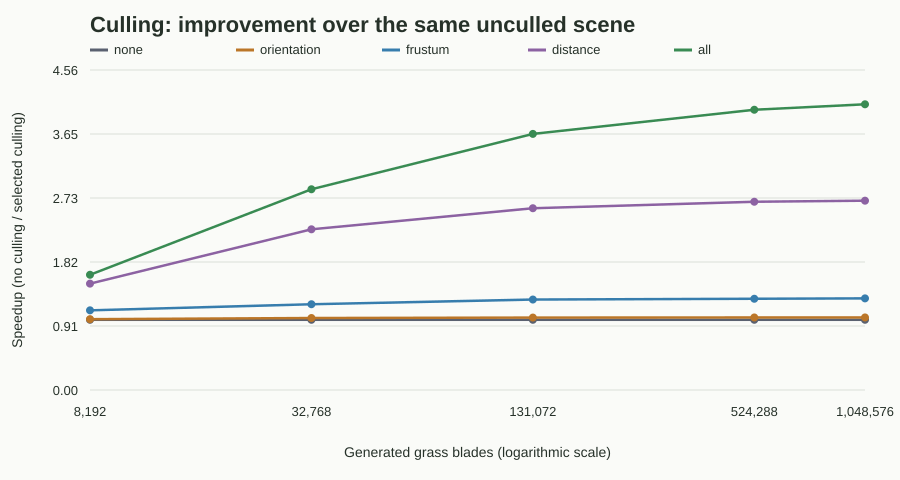

At 1,048,576 blades, independent speedups are **1.03×** for orientation, **1.30×** for frustum, **2.70×** for distance. Their retained populations are approximately 1,009,736, 761,858, 329,537 blades, respectively. Rejection sets overlap, so the savings cannot be added.

The orientation threshold of 0.98 preserves dense clump coverage and rejects only nearly edge-on blades. Its smaller rejection rate gives less opportunity to save work. At 8,192 blades, orientation takes 0.0820 ms versus 0.0827 ms without culling; the summary records the run ranges for interpreting this small difference.

Distance culling saves substantial work by reducing distant density. Physics remains a floor: at one million blades, simulation spans 0.2881–0.2899 ms across the five modes because every blade still simulates. Visibility/packing changes from 0.2981 ms without rejection to 0.1681 ms with all three tests, reducing the number of full blade records written.

### LOD and occlusion

These pairs use the `final` preset, including enhanced shading, directional shadows, and sphere interaction. Settings match within each pair. LOD uses the overview camera; occlusion uses the blocker-heavy occluder camera. These are separate experiments from the baseline table.

| Experiment at 524,288 blades | Disabled | Enabled | Effect |
| --- | ---: | ---: | --- |
| Adaptive tessellation | 1.2549 ms | 0.9879 ms | 21.3% less GPU time; 1.27× speedup; about 87,852 visible blades |
| Occlusion, with LOD on | 0.8462 ms | 0.8378 ms | 1.0% less GPU time; survivors fall from 83,934 to 57,691 |

Occlusion removes **31.3%** of blades surviving the other tests. The enabled depth prepass/hierarchy costs 0.0553 ms, and visibility testing also has overhead. These costs limit the total benefit relative to the survivor reduction. Disabling occlusion skips the additional prepass and hierarchy. The directional shadow pass is independent and included on both sides of these enhanced-rendering comparisons.

### Data and measurement limits

[Raw CSVs, commands, metadata, and source hashes](performance/raw/manifest.json) and the [summary table](performance/summary.csv) preserve measurements for source revision `5534108b3628826e967717e661beaf88f4aae3ab`. The summary includes minimum and maximum run medians. Results apply to this GPU, scene, camera, and density policy. Trials are short, and GPU clocks and temperature are not recorded.

GPU queries record simulation, visibility, occlusion depth work, directional shadow work, a graphics tail interval, and the total frame span. The graphics tail may include unfinished opaque fragments. Stage intervals can overlap and should not be added. Readback and presentation are outside GPU timing. CPU time is measured separately; inverse GPU time is not application FPS.

## Build and run

Use a Vulkan 1.1-capable GPU with tessellation support, the [Vulkan SDK](https://vulkan.lunarg.com/), a current GPU driver, CMake 3.16 or newer, and a C++17 compiler. GLFW, GLM, and STB are already included in the starter.

From the repository root:

```sh
cmake -S . -B build -DCMAKE_BUILD_TYPE=Release
cmake --build build --parallel
./build/bin/vulkan_grass_rendering
```

On Linux, install the X11 development packages required by bundled GLFW. `tools/setup_gpu_ubuntu.sh` documents the tested Ubuntu GPU-host toolchain setup, including the official NVIDIA driver and LunarG SDK downloads. A hardware-backed display is required even for a hidden GLFW window. On a server without a desktop, reboot after the driver installation, run `sudo bash tools/start_gpu_display.sh`, and set `DISPLAY=:0`. Load the SDK with `source /opt/VulkanSDK/1.4.363.0/setup-env.sh`; verify the selected GPU with `vulkaninfo --summary` and run `vkcube`. The display helper uses a local Unix socket and disables X11 TCP listening.

| Input | Action |
| --- | --- |
| Left / right mouse drag | Orbit / zoom the camera |
| W, A, S, D and Q, E | Move the sphere horizontally and vertically |
| Arrow keys | Rotate wind and change its strength |
| 1, 2, 3, 4 | Toggle orientation, frustum, distance, and occlusion culling |
| L / F / H / B | Toggle adaptive tessellation / wireframe / controls overlay / enhanced shading |
| Space / R / Escape | Pause / reset the grass / exit |

Use `--help` for all command-line options. Examples:

```sh
./build/bin/vulkan_grass_rendering --blades 1048576 --culling all
./build/bin/vulkan_grass_rendering --preset wireframe --camera grazing
./build/bin/vulkan_grass_rendering --preset interaction
./build/bin/vulkan_grass_rendering --preset final --camera interaction --sphere-motion sweep --wind-strength 0
./build/bin/vulkan_grass_rendering --preset final --camera detail --render-disable transmission
python3 tools/check.py build/bin/vulkan_grass_rendering
python3 tools/test_grass_math.py
python3 tools/check_visuals.py build/bin/vulkan_grass_rendering
python3 tools/check_interaction.py build/bin/vulkan_grass_rendering --output performance/checks/interaction
python3 tools/benchmark.py build/bin/vulkan_grass_rendering --extras
python3 tools/analyze.py performance/raw
python3 tools/capture.py build/bin/vulkan_grass_rendering
python3 tools/record_walkthrough.py build/bin/vulkan_grass_rendering
```

The X11 interaction smoke test additionally uses `xdotool` and FFmpeg as development tools; the Ubuntu setup helper installs both. Debug builds enable Vulkan validation by default. Automated correctness, benchmark, and capture modes finish after the requested frame count and return an error code on failure.

**Build-system changes:** `CMakeLists.txt`, `src/CMakeLists.txt`, and `external/GLFW/CMakeLists.txt` were changed beyond source-file lists. Changes select C++17, compile GLSL to SPIR-V on supported platforms, build the executable from the current renderer/scene entry points, and place generated shaders beside the executable in `build/bin`. The bundled GLFW CMake minimum was raised to 3.16 and its obsolete CMP0042 OLD override removed for modern CMake compatibility. Dependency C/C++ source remains unchanged.

## Verification

[Recorded checks](performance/validation.json) include the SDK cube, all 14 compiled/validated shaders, Debug and Release builds, and 11 validation-enabled GPU cases. Cases cover zero blades, partial workgroups, all survivors, a populated field with zero survivors, physics, interaction, wireframe, and occlusion. The GPU check enforces finite state, ground constraints, static-object clearance, counter bounds, and approximate length within 1% plus a small absolute tolerance.

Seven numerical tests check continuous blade frames, surface derivatives, degenerate curves, front/back normals, and length correction. The CPU scene suite covers exact counts, deterministic placement, small fields, blocked-field failure, cameras, input edges, and stable light bounds; it also passes address and undefined-behavior sanitizers.

The X11 smoke test exercises resize and keyboard controls, verifies identical paused pixels and changed pixels after resuming, and checks that early closure of an automated run returns failure. A separate native-window-manager check confirms minimize/restore. Matching rendering comparisons verify that each enhancement affects pixels without changing blade counts. Occlusion comparisons include same-setting repeat controls. A relocated binary runs while the original shader directory is hidden.

The [walkthrough report](performance/validation/walkthrough-report.json) records actual keyboard and mouse inputs, encoder readiness, video dimensions/frame rate/duration, clean application exits, and validation results. Its three chapters demonstrate every input listed above.

Validation uses `VK_LAYER_VALIDATE_SYNC=true` with `--validation on`. Linux/NVIDIA is the tested platform; Windows build paths are retained but were not runtime-tested here.

## References

- [CIS 5650 Project 5 starter and assignment](https://github.com/CIS5650-Fall-2026/Project5-Vulkan-Grass-Rendering), baseline `d3c78889caadbcad7bc3b894b8714e34c62f3361`.
- [Responsive Real-Time Grass Rendering for General 3D Scenes](https://www.cg.tuwien.ac.at/research/publications/2017/JAHRMANN-2017-RRTG/JAHRMANN-2017-RRTG-draft.pdf), Klemens Jahrmann and Michael Wimmer, 2017. Mathematical model and algorithm reference.
- The supplied Introduction to Vulkan decks and Project 5 recitation slides.
- [Vulkan specification](https://registry.khronos.org/vulkan/) and [synchronization guidance](https://docs.vulkan.org/guide/latest/synchronization_examples.html). API reference.
- [Tessellation tutorial](https://ogldev.org/www/tutorial30/tutorial30.html). Conceptual reference; no sample code imported.
- [Procedural Grass in Ghost of Tsushima](https://www.youtube.com/watch?v=Ibe1JBF5i5Y), Eric Wohllaib, GDC 2021. Visual concepts studied through the official presentation slides.
- [README presentation guide](https://github.com/pjcozzi/Articles/blob/master/CIS565/GitHubRepo/README.md).
