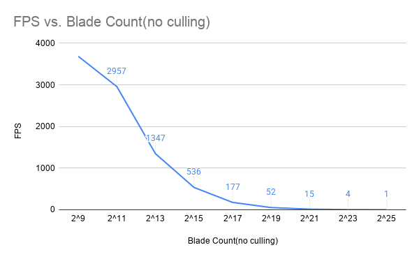
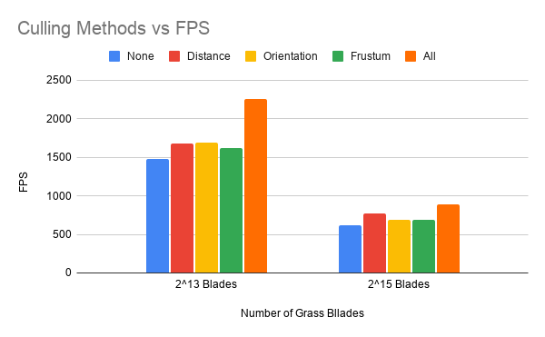

Vulkan Grass Rendering
==================================

**University of Pennsylvania, CIS 565: GPU Programming and Architecture, Project 5**

* Yanfu Ou
* Tested on: Ubuntu24.04, Ryzen4-7480HS @ 3.0GHz 64GB DDR4, RTX5070 8GB

`src/CMakeLists.txt` was modified beyond the source file list. On Linux, `glslangValidator` compiles the shaders during the build.

### Overview

2^13 = 8192 grass blades rendering simulation. 

This project used Vulkan to render physics realistic grass, and is an implementation of the paper [Responsive Real-Time Grass Rendering for General 3D Scenes](https://www.cg.tuwien.ac.at/research/publications/2017/JAHRMANN-2017-RRTG/JAHRMANN-2017-RRTG-draft.pdf). In the simulation, a blade of grass is described by three vertices, v0, v1, and v2, which are the control points of a Bezier curve. To make the movement of grass more realistic, the simulator also take into account gravity, recovery, and wind. In order to make the simulation computationally efficient, the simulator culls grass blades that are not visible, implementing distance and orientation culling. 

### Rendering
Each blade is one tessellation patch. The evaluation shader walks the Bezier curve from root to tip, tapers the width to a point, and writes clip space. With the forces left off, every blade stays in the pose it was generated with.

### Forces
To make grass more realistic, this project attempts to model the physics of how grass naturally behaves in nature. This involves modeling the effects of gravity acting on the grass blade, grass's natural recovery tendencies due to its structure, and the wind's effect on the grass blade. This is used to calculate the displacement added to v2 on each frame using `(gravity + recovery + wind) * dt`, with `dt` clamped to 0.05 s. The three clips below add one term at a time, and the last clip runs the section 5.2 correction on top of all three.

#### Gravity
With just gravity force implemented, you see that all grass blades collapsed on the floor. This is because graity is a constant acceleration `D = (0, -1, 0, 5)` along the facing direction of the blade, plus a smaller sideways component `0.25 * |g|` along the blade's face. Recovery and wind are off, so the blades bend over and stay down. 

#### Gravity and recovery

With recovery implemented, you can see that it counteracts the effects of gravity, keeping the grass blade at a certain consistent range of height. This is because recovery pulls v2 back toward the upright tip, `v0 + up * height`, scaled by the blade's stiffness (between 7 and 13). The blades sag, then settle into a lean instead of lying flat.

#### Gravity and recovery and wind
With wind implemented, you can see that the grass blades started swaying. This is because wind is a gust whose direction depends on the blade's position and the elapsed time. It is stronger when the blade faces the wind and while the blade is still upright. The settled lean keeps swaying.

#### Gravity, recovery, wind, and length correction
With length correction, you can see that the grass looks more natural. This is because moving v2 alone lets the tip pass through the ground and changes the length of the curve. The correction lifts any part of v2 that points through the ground, places v1 back on the up axis at a height that follows the bend, and scales both segments so the quadratic curve length stays equal to the blade height.

### Culling
Culling raises the frame rate by not drawing blades that would not show up. The compute shader still applies forces to every blade. A blade is copied into the draw buffer only after it passes the tests, and the indirect draw uses that count. The clips below turn on one test at a time.

#### Distance culling
In the clip, moving the camera back culls the far side of the patch first. The field thins, and once every root is past 45 units the patch is gone. Distance is the ground distance from the camera to the root, so a tall blade is not treated as farther away. Blades inside that range are split into 8 buckets: the nearest keeps every blade, and each farther bucket keeps fewer, chosen by `id % 8`.

#### Orientation culling
In the clip, when the grass blade's width direction is perpendicular to the blade's face, it is culled.  This means a blade is dropped when the view direction is nearly parallel to that width, `|dot(view, width)| > 0.9`, which is the edge-on case the paper cuts at 0.9. Those blades would cover less than a pixel.

#### View-frustum culling
In the clip, if parts of the grass if outside of the viewing windows, it is culled. Samples along the curve, including both width corners, are tested against the window. If any sample is outside, the whole blade is dropped, so a tip that crosses the border is removed instead of being sliced by the rasterizer. The grass ends cleanly at the edge of the window.

The clip is exaggerated to show this effect. 

## Performance

Frame time is the rate of the render loop, averaged over half a second. The same camera position is used within each table.

### Number of Blades Comparison

| Blade Count(no culling) | 2^9  | 2^11 | 2^13 | 2^15 | 2^17 | 2^19 | 2^21 | 2^23 | 2^25 |
|-------------------------|------|------|------|------|------|------|------|------|------|
| FPS                     | 3685 | 2957 | 1347 | 536  | 177  | 52   | 15   | 4    | 1    |

With culling off, FPS stays in the thousands from 512 blades up through 8192, then falls off as the blade count grows. From 2^15 to 2^25 the count increases by 1024× and the frame rate falls from 536 to 1, so the cost is close to linear in the number of blades. Tessellation and rasterization of every blade dominate. Below about 2^13 the GPU is not full, which is why multiplying the count by 16 only drops the frame rate from 3685 to 1347.

### Culling Method Comparison
Each column turns on one test. "None" represents using no culling methods and serves as a baseline. The performance benchmark records the FPS count of each culling methods. "All" runs the three tests together. These runs are separate from the table above, so the no-cull baselines (1474 and 614) differ from the 1347 and 536 in that table.

| Culling Methods | None | Distance | Orientation | Frustum | All  |
|-----------------|------|----------|-------------|---------|------|
| 2^13 Blades     | 1474 | 1682     | 1690        | 1617    | 2251 |
| 2^15 Blades     | 614  | 774      | 687         | 685     | 890  |

At 8192 blades, distance and orientation each add about 14% over no culling, and the frustum test adds about 10%. At 32768 blades, distance adds 26% while orientation and frustum stay near 12%. Distance removes a larger share of the tessellation work once the field is dense, because far buckets drop most of their blades. Orientation only removes the edge-on facings, a small fraction of a random field, so its gain barely changes with count. The frustum test only removes blades that leave the window, and with the camera aimed at the patch most blades are still drawn. Running all three reaches 2251 FPS at 8192 blades (about 53% over the baseline) and 890 FPS at 32768 (about 45%), which is more than any single test because the three tests drop different blades.