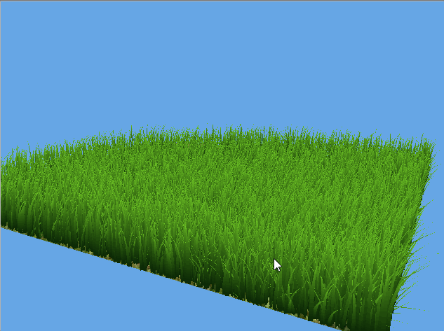
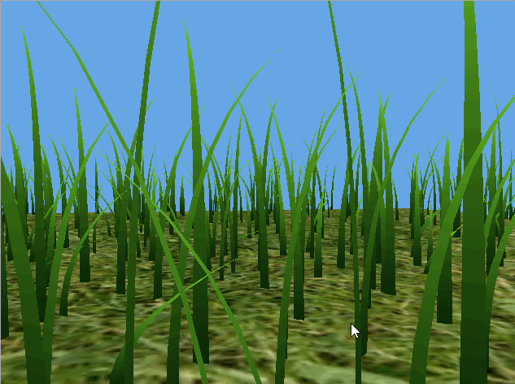
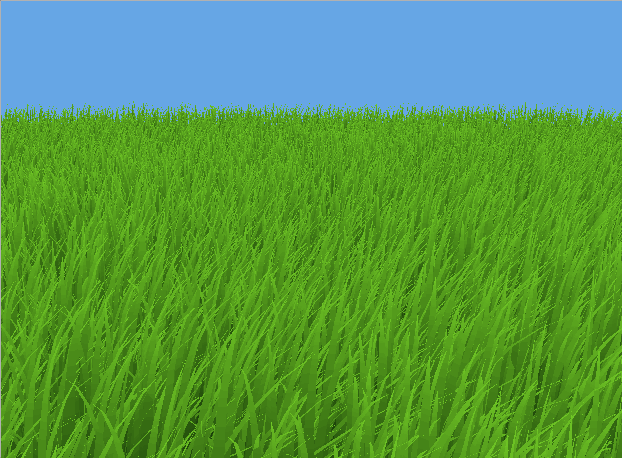
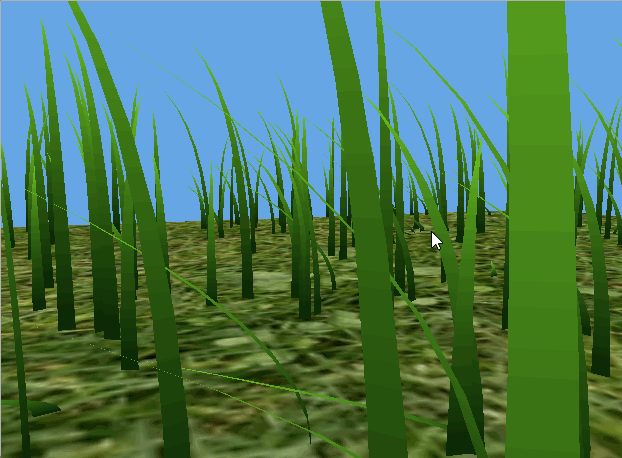

Vulkan Grass Rendering
==================================

**University of Pennsylvania, CIS 565: GPU Programming and Architecture, Project 5**

* Rayyan Shaik - [LinkedIn](https://www.linkedin.com/in/rayyan-shaik)
* Tested on: Windows 11, AMD Ryzen 7 5700H @ 3.3GHz 32GB, Mobile RTX 3070 (Personal Computer)

## Overview

  
  

<!-- Never knew util trying to align these side by side that html worked in markdown -->

At a high level, this project implements [Responsive Real-Time Grass Rendering for General 3D Scenes](https://www.cg.tuwien.ac.at/research/publications/2017/JAHRMANN-2017-RRTG/JAHRMANN-2017-RRTG-draft.pdf) by Jahrmann and Wimmer in Vulkan. This project renders grass in Vulkan using tessellated Bezier curves to represent individual blades, with forces such as wind and gravity shaping their motion. GPU-based (compute shader) culling removes blades that do not contribute to the current view, reducing rendering work and improving performance in dense grass fields.

## Features

### Grass Geometry + Rendering

Each grass blade is represented by a quadratic Bezier curve with three control points, along with properties such as: height, width, and orientation. The tessellation shaders generate blade geometry by evaluating the curve and offsetting vertices across its width. Each blade tapers toward its tip and uses a dark-to-light green gradient from root to tip for style. Randomized positions, orientations, heights, and widths add variation across the field/grid plane.

### Physics - Simulating External Forces

Grass motion is simulated in a compute shader using gravity, recovery (spring), and wind forces. Gravity includes an environmental component and a contribution based on the blade’s facing direction, while recovery pulls the tip toward its initial position according to stiffness. Wind varies with time and position, with its effect scaled by the blade’s alignment to the wind. The combined forces update the tip each frame, giving the blade curve variation.

### Culling (Rendering Optimizations)

| Distance Culling | Orientation Culling |
|:---:|:---:|
|  |  |
| Grass density decreases with distance from the camera | Blades viewed nearly edge-on are culled |

The compute shader also applies orientation, view-frustum, and distance culling to reduce the number of grass blades rendered. Orientation culling removes blades viewed nearly edge-on, while frustum culling checks the root, midpoint, and tip against the camera’s view-frustum volume. Distance culling removes blades beyond a maximum distance and thins visual blade density as that maximum distance is approached. Surviving blades are rendered.

## Performance 
FPS was measured using the number of frames processed over one-second intervals, with the camera position and window resolution held constant for each comparison.

### Number of Blades
| __Blade count (no culling)__ | 2^10 | 2^12 | 2^14 | 2^16 | 2^18 | 2^20 | 2^21 |
|---|---|---|---|---|---|---|---|
| __FPS__ | 6929.9 | 4076.3 | 1412.9 | 351.6 | 88.6 | 24.6 | 12.4 |

_This scene used a 20x20 grid as a floor plane and the camera was set to a fixed position_

At higher blade counts, it appears frame time grows approximately linearly with the number of blades. (As expected) this suggests that per-blade work dominates over fixed application overhead. Without culling, every blade is simulated, tessellated, and submitted for rendering, even when it contributes little to the image. Beyond 2^16 blades, the FPS curve begins to flatten, so further increases produce smaller absolute FPS drops. This does not indicate improved scaling: frame time still grows approximately linearly with blade count, while FPS is its reciprocal.

### Culling Methods

| __Culling__ | None | Orientation | Frustum | Distance | All |
|---|---|---|---|---|---|
| __FPS__ | 24.7 | 33.6 | 83.2 | 141.1 | 436.9 |
| __Settings__ | — | Threshold < 0.9 | — | Max dist = 35; buckets = 10 | — |

_This scene used 2^20 blades, a 50x50 grid as a floor plane, and the camera was set to a fixed position_

As described by the table and chart, all three culling methods improve performance, with distance culling providing the largest individual benefit in this scene. Its density reduction removes work even within the visible region, while orientation and frustum culling depend more strongly on blade alignment and camera placement. Combining all three increases performance from 24.7 to 436.9 FPS -- approximately a 18x speedup—showing that they eliminate complementary sources of rendering work. Since every blade is still simulated, these gains suggest that avoiding unnecessary tessellation and rendering substantially reduces the overall frame cost.

These gains depend on the scene and camera configuration. Distance culling is generally more effective when a larger proportion of grass lies far from the camera, while offering less benefit when all grass is nearby. Frustum culling similarly provides little benefit when the entire field is visible, and its additional compute work may outweigh the rendering savings when few blades are rejected.

## CMake Changes
`external/GLFW/CMakeLists.txt` was modified to include `cmake_policy(SET CMP0042 NEW)`