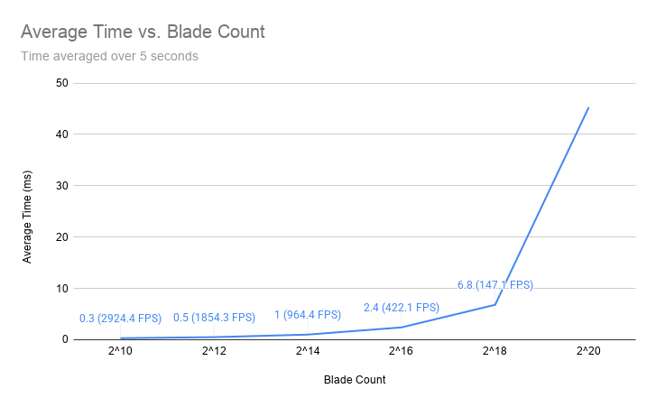
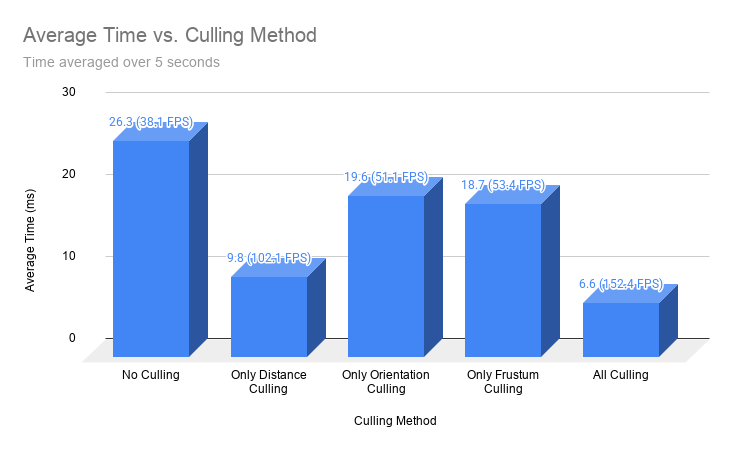

Vulkan Grass Rendering
==================================

**University of Pennsylvania, CIS 565: GPU Programming and Architecture, Project 5**

* Grace Tan
* Tested on: Windows 11 Home 25H2 (Build 26200), AMD Ryzen 9 8945HX @ 2.50GHz, 16GB RAM, NVIDIA GeForce RTX 5060 Laptop GPU 8GB

## Highlights
- Real-Time rendering of grass influenced by physical forces
- Tessellation pipeline building blade geometry from a compact set of parameters
- 3 types of per-blade culling for improving performance 
- Perlin-noise wind producing natural swaying grass movement
- Blinn-Phong and Lambertian shading for glossy blades

## Vulkan 
Vulkan is a low-overhead, cross-platform graphics and compute API from the Khronos Group. Unlike OpenGL, which hides most of the GPU's state management inside the driver, Vulkan makes the application responsible for things like memory allocation, resource synchronization, command buffer recording, and pipeline creation. This is more verbose, but it gives predictable performance, lower CPU overhead (command buffers can be recorded ahead of time and on multiple threads), and direct control over how work is scheduled on the GPU. 

The goal is to implement Jahrmann and Wimmer's [Responsive Real-Time Grass Rendering for General 3D Scenes](https://www.cg.tuwien.ac.at/research/publications/2017/JAHRMANN-2017-RRTG/JAHRMANN-2017-RRTG-draft.pdf) with two pipelines: a compute pipeline for per-blade physics and culling, and a graphics pipeline (vertex, tessellation, and fragment stages) for rendering. 

## Paper Overview
Older techniques draw grass as billboards or textured slices, which look different from different viewing angles and can't react convincingly to wind or collisions. The paper instead draws every blade as real geometry, which lets each blade respond to its environment. To keep that affordable, it runs a physical model and several culling tests per blade on the GPU, then uses indirect rendering so only the surviving blades are drawn.

### Blade model

A blade is defined by three control points of a quadratic Bézier curve:

- `v0`: the fixed root position on the ground
- `v1`: a guide control point, positioned based on `v2`
- `v2`: the tip, which the physical model moves

Each blade also stores a height, width, stiffness coefficient, up-vector, and direction angle. Together this fits in four `vec4`s (64 bytes per blade).

### Physical model

Each frame, the compute shader computes a translation for the tip `v2` from three natural forces:

- **Recovery:** a spring-like force (Hooke's law) pulling the tip back toward its initial pose, scaled by the blade's stiffness.
- **Gravity:** an environmental gravity plus a smaller "front gravity" perpendicular to the blade's width, which bends the tip forward the way as a real, flexible grass blade would.
- **Wind:** a function of the blade's root position and time gives a wind vector. It is then scaled by how aligned the blade is with the wind.

The total displacement is `δ = (recovery + gravity + wind) * Δt`. 

### State validation

After the forces move `v2`, the blade is corrected so it stays physically plausible:

1. **`v2` stays above the ground:** it is clamped against the local plane defined by the blade's up-vector.
2. **`v1` is repositioned from `v2`:** the more the tip is pushed sideways, the lower `v1` sits above `v0`, with a small minimum so the blade always keeps a slight curve.
3. **Length is preserved:** the Bézier length is approximated as `(2·L0 + (n−1)·L1) / (n+1)`, and the control points are rescaled by `height / length` so blades don't stretch or shrink when bent.

### Culling

Blades that won't visibly contribute are removed in the compute shader, and the survivors are counted into the indirect draw buffer:

- **Orientation test:** blade profiles can be thinner than a pixel and cause aliasing, so they are culled.
- **View-frustum test:** the blade is culled if none are inside the view frustum.
- **Distance test:** distant blades are culled progressively, in distance levels, to avoid overly dense far-away grass.

### Rendering and blade geometry

Surviving blades are drawn with an indirect draw call, using the vertex count the compute shader wrote to the draw buffer. Each blade is a single tessellation patch. The evaluation shader turns the tessellated `(u, v)` coordinates into positions:

- **Height (`v`):** de Casteljau's algorithm on `v0, v1, v2` gives the curve point `c` and tangent `t0`.
- **Width (`u`):** `c0 = c - w·t1` and `c1 = c + w·t1` span the blade, interpolated by `t = u + 0.5v - uv` to form a triangle shape.
- **Normal:** `n = normalize(t0 × t1)`, used for Blinn-Phong lighting in the fragment shader.

## Demo

## Performance Analysis 

<table>
  <tr>
    <td align="center">
       
    </td>
  </tr>
</table>

<table>
  <tr>
    <td align="center">
       
    </td>
  </tr>
</table>
